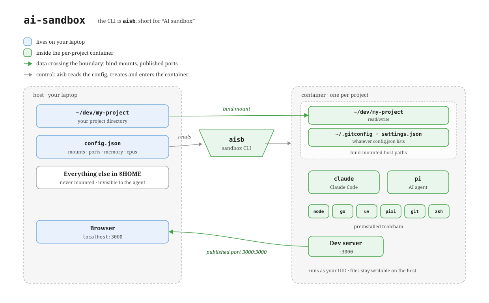

# ai-sandbox

[](https://github.com/aktech/ai-sandbox/actions/workflows/ci.yml)
[](https://github.com/aktech/ai-sandbox/actions/workflows/image.yml)
[](https://github.com/aktech/ai-sandbox/actions/workflows/release.yml)

Run AI coding agents (Claude Code, Codex, pi, etc.) in a Docker container instead
of directly on your laptop. Each project gets its own container, and the
container can only see the folders you explicitly mount in. If the agent
goes wrong, you lose the container — not your home directory.

The CLI is called `aisb`. One command spins up (or re-enters) a sandbox
for the current project and drops you into a shell where `claude`,
`codex`, and `pi` are already installed.



## Getting started

You need Docker running. On macOS, [colima](https://github.com/abiosoft/colima)
works well (`colima start`). Nothing else: you do not need to clone this
repository or install Go.

**1. Install `aisb`.** Download the binary for your machine from the
[latest release](https://github.com/aktech/ai-sandbox/releases/latest), check
its checksum, and put it on your `PATH`:

```sh
OS=$(uname -s | tr '[:upper:]' '[:lower:]')
ARCH=$(uname -m | sed 's/x86_64/amd64/; s/aarch64/arm64/')
F=aisb-$OS-$ARCH
curl -fsSLO "https://github.com/aktech/ai-sandbox/releases/latest/download/$F.tar.gz"
curl -fsSLO "https://github.com/aktech/ai-sandbox/releases/latest/download/$F.tar.gz.sha256"
shasum -a 256 -c "$F.tar.gz.sha256"     # must print: OK
tar -xzf "$F.tar.gz"
mkdir -p ~/.local/bin && install -m 0755 "$F" ~/.local/bin/aisb
aisb help                               # if "command not found": add ~/.local/bin to your PATH
```

**2. Build the sandbox image** (one-time, about 5 minutes). Everything it
needs is inside the `aisb` binary:

```sh
aisb build
```

**3. Start a sandbox** in any project:

```sh
cd ~/dev/my-project
aisb             # first run: creates a container, drops you into zsh
                 # next runs: re-enters the same container
```

**4. Optional:** choose what the sandbox can see ([What gets mounted](#what-gets-mounted))
and keep your API keys out of it ([Keeping credentials out of the sandbox](#keeping-credentials-out-of-the-sandbox)).

**Upgrading:** download the new release the same way, then run `aisb build`
again. It rebuilds the sandbox image, and the proxy image too if you use proxy
mode, so they match the new `aisb`.

**Building from source** (contributors): `make build` writes `./bin/aisb`
from a checkout; it needs Go. Everything after that is the same.

## Use it

```sh
cd ~/dev/my-project
aisb             # first run: creates a container, drops you into zsh
                 # next runs: re-enters the same container
```

Inside the container, run `claude`, `codex`, or `pi` like you normally would.

| Command          | What it does                                  |
|------------------|-----------------------------------------------|
| `aisb`           | Enter the sandbox for the current project.    |
| `aisb stop`      | Stop the current project's container.         |
| `aisb rm`        | Delete the current project's container.       |
| `aisb ls`        | List all sandboxes.                           |
| `aisb status`    | Show one container's status.                  |
| `aisb build`     | Build or rebuild the image(s).                |

## What gets mounted

By default the container only sees the project directory. Anything else
you want available — your `.gitconfig`, dotfiles, a shared library — you
list in a config file:

`~/.config/ai-sandbox/config.json`

```json
{
  "default": {
    "mounts": [
      "{{HOME}}/.gitconfig",
      "{{HOME}}/.claude/settings.json",
      "{{CWD}}"
    ]
  },
  "projects": {
    "/Users/me/dev/my-project": {
      "extra_mounts": ["~/dev/shared-lib"],
      "memory": "8g",
      "cpus": 4,
      "gpus": "all",
      "ports": ["3000:3000", "8000:8000"]
    }
  }
}
```

- `mounts` — the full list. Each entry becomes a `-v` bind mount. Write
  `src` to mount a host path at the same path inside the container, or
  `src:dest` to mount it at a different path (e.g. a repo-local gitconfig
  at `~/.gitconfig` inside the sandbox).
- `extra_mounts` — appended to `mounts`. Use for per-project additions.
- `copies` / `extra_copies`: host paths copied *into* the sandbox when its
  container is first created, using the same `src` / `src:dest` syntax as
  `mounts`. Unlike a mount, nothing the agent changes ever flows back to the
  host, so this is the safe way to pre-warm caches such as `~/.cache/pip` or
  `~/go/pkg/mod`. A directory's contents land at `dest`. Copies run in the
  background by default; `aisb --wait-copies` waits for them before opening
  the shell. They only happen on creation (`aisb rm` then `aisb` to redo
  them) and are skipped by `aisb create`.
- `memory`, `cpus`, `gpus`, `image` — optional overrides. Set them under
  `default` to apply everywhere, or under a project to scope them.
- `gpus` — passed straight to `docker run --gpus` (`"all"`, `"device=0,1"`,
  or a count like `"2"`). Omit it (the default) for no GPU. Requires the
  [NVIDIA Container Toolkit](https://docs.nvidia.com/datacenter/cloud-native/container-toolkit/latest/install-guide.html)
  on a Linux host with NVIDIA drivers — it does **not** work under colima/macOS.
- `ports` — each entry becomes a `-p host:container` publish, so a server
  you start inside the sandbox is reachable from your laptop browser. With
  `"3000:3000"`, a dev server on `:3000` inside shows up at
  `http://localhost:3000` on the host.

Two sandboxes can both serve `:3000` *inside*, but the host side of a
publish is shared: if two projects map to the same host port (e.g. both
`"3000:3000"`), only the first container binds and the second fails with
`port is already allocated`. Give each project a distinct host port for
the same container port: `"3001:3000"`, `"3002:3000"`, and so on. Ports are
fixed when the container is created, so changing them needs `aisb rm`
followed by `aisb`.

Placeholders: `{{HOME}}`, `{{CWD}}`, `{{SHARED_DIR}}`. Shell-style `~/`
and `$VAR` also work, on both sides of a `src:dest` entry. Paths that
don't exist on the host are skipped with a warning.

## Environment overrides

| Var                 | Default                              |
|--------------------|--------------------------------------|
| `AISB_IMAGE_NAME`   | `ai-sandbox-pi:latest`               |
| `AISB_MEMORY`       | `4g`                                 |
| `AISB_CPUS`         | `2`                                  |
| `AISB_GPUS`         | none (e.g. `all` to expose all GPUs) |
| `AISB_SHARED_DIR`   | `~/sb-shared`                        |
| `AISB_CONFIG_FILE`  | `~/.config/ai-sandbox/config.json`   |
| `ANTHROPIC_API_KEY` | passed through to the container      |
| `AISB_PROXY_IMAGE`  | `ai-sandbox-proxy:latest`            |
| `AISB_MASTER_PASSWORD` | unlocks the secret store non-interactively |

## Keeping credentials out of the sandbox

By default `aisb` passes your `ANTHROPIC_API_KEY` straight into the container.
That means a misbehaving agent can read it. The optional credential proxy
removes every real secret from the sandbox: the agent sees only placeholder
values, and a separate proxy on your machine swaps in the real secret as each
request leaves.

How it works:

- Real secrets live in an encrypted file on your host
  (`~/.config/ai-sandbox/secrets.enc`), unlocked with a master password.
- A small `aisb-proxy` container holds the decrypted secrets in memory (they
  are handed to it over a pipe, never written to disk or passed as env/args).
- Each sandbox runs on its own private Docker network that has **no route to
  the internet**. The proxy is the only way out, so the domain allowlist is
  enforced by the network itself, not by the agent's good behavior.
- Inside the sandbox, the env var you name in `proxy.env` (e.g. `GH_TOKEN`) is
  set to a sentinel like `__aisb_<secret>__`. When the agent calls an
  allowlisted host that has an inject rule, the proxy replaces the sentinel in
  the header with the real secret. The agent never holds the key. Which secret
  goes in which env var and which header is entirely config-driven; nothing is
  hardcoded.

Set it up once:

**1. Initialise proxy mode.** This asks you to choose a master password (typed
twice; it cannot be recovered), creates the encrypted secret store, and builds
the proxy image from the `aisb` binary:

```sh
aisb proxy init
```

**2. Store your keys.** Each key gets a name you choose; you are asked for the
master password, then the value (or pipe the value in):

```sh
aisb secret set github                              # prompts for the value
printf '%s' "$ANTHROPIC_API_KEY" | aisb secret set anthropic
```

**3. Add a `proxy` block to your config** (`~/.config/ai-sandbox/config.json`)
saying which hosts sandboxes may reach and where each key goes:

```json
{
  "default": {
    "mounts": ["{{CWD}}"],
    "proxy": {
      "allow": ["registry.npmjs.org", "pypi.org", "files.pythonhosted.org"],
      "env": { "github": "GH_TOKEN", "anthropic": "ANTHROPIC_API_KEY" },
      "inject": {
        "api.github.com":    {"header": "Authorization", "secret": "github", "format": "Bearer %s"},
        "github.com":        {"header": "Authorization", "secret": "github", "basic": true},
        "api.anthropic.com": {"header": "x-api-key", "secret": "anthropic"}
      }
    }
  },
  "projects": {
    "/Users/me/dev/my-project": { "extra_allow": ["files.pythonhosted.org"] },
    "/Users/me/dev/scratch":    { "proxy": { "allow": ["*"] } }
  }
}
```

- `env` maps each secret name to the environment variable the sandbox sets to
  that secret's sentinel, so a CLI inside believes it is authenticated. Pick
  whatever names your tools read (`GH_TOKEN`, `ANTHROPIC_API_KEY`, etc.).
- `allow` is default-deny: only listed hosts are reachable. `*.` matches any
  subdomain depth; a plain entry matches that exact host. A host you inject
  into is allowed automatically.
- `inject` says which header to rewrite per host. `format` wraps the value
  (e.g. `Bearer %s`); `basic` handles `git push` over HTTPS, which sends the
  token as the password half of a Basic-auth header.
- `default.proxy.allow` is the **universal** list, applied to every project.

**4. Run `aisb` in a project.** It starts the proxy and asks for the master
password once (it stays running until `aisb proxy stop`; set
`AISB_MASTER_PASSWORD` to skip the prompt). If anything is missing, `aisb`
says exactly which command to run. To turn proxy mode off again, remove the
`proxy` block.

### Per-project allowlists

The single shared proxy enforces a **different allowlist per project**. It tells
which project a request came from by the sandbox's own network, so each
project's rules are isolated from the others.

- `extra_allow` (per project) adds hosts on top of the universal list for that
  project only.
- A per-project `"proxy": { "allow": [...] }` block adds more hosts for that
  project. Use `"allow": ["*"]` to make a project **unrestricted** (reach any
  host). Even an unrestricted project still has its secrets injected and kept
  out of the container; only the egress limits are lifted.

Rules update live: entering a project pushes its allowlist to the running proxy
(no master password needed, since rule updates carry no secrets). Removing a
sandbox (`aisb rm`) drops that project's rules.

Once a `proxy` block is present, `aisb` starts the proxy and the private
network automatically. With no `proxy` block, `aisb` behaves exactly as before.

| Command            | What it does                                   |
|--------------------|------------------------------------------------|
| `aisb proxy init`   | One-time setup: password, store, proxy image.  |
| `aisb secret set X` | Store a secret (value read from stdin/no-echo).|
| `aisb secret ls`    | List stored secret names (never values).       |
| `aisb secret rm X`  | Remove a secret.                               |
| `aisb proxy stop`   | Stop the shared proxy container.               |
| `aisb proxy log`    | Stream the proxy's allow/deny decisions.       |

Git over SSH (`git@github.com:...`) is out of scope for now: use HTTPS
remotes so the proxy can inject your token. Projects that publish `ports`
also need an inbound forwarder that is not yet built, so `ports` and proxy
mode do not yet combine.

## What's in the image

Debian slim with `claude`, `codex`, `pi`, Node, Go, `uv`, `pixi`, `git`, `zsh`.
The container runs as a non-root user whose UID/GID matches your host,
so files you create inside stay writable from outside.
